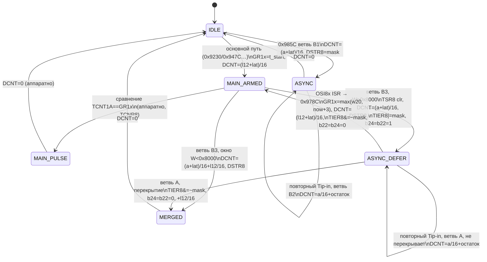

# v73 — SH7055: машина состояний выхода форсунки, латентность, маска запрета, порты

**Дата:** 2026-10-26. **Статус:** статический read-only анализ. Прошиваемых BIN и патчей нет. Работа не связана с Delta MAP.

## 0. Исходные данные и уровни достоверности

- ROM: proxy `forester_sg9_sti_MAP_IAT_GM_dMap_v63.bin` (SHA-256 `2ee7056b…ebc6eef8`); код из v69–v72 совпадает на v63–v70. Все находки — **`PROXY-CONFIRMED`**.
- Оригинального v39 (`43a4751d…`) и CarBerry BIN (`b06e1282…`) в доступных репозиториях **нет**. Ни один вывод ниже не выдаётся за проверку v39 или кода HC16.
- **Важно:** в proxy есть сторонний патч в логике отсечки: `0x25760 JMP 0x7E700` (код в `0x7E700..0x7E75C`, использует `B1E9` — сцепление по логгеру — и `B204`). Пункт §5 про `B868` поэтому особенно требует сверки с v39.
- Внешние источники (`REFERENCE`): fenugrec/npkern `reg_defines/7055_350nm.h` (адреса регистров) и RomRaider-логгер для ECU ID `1356212FFF` (имена RAM).
- Назначение битов регистров ATU-II/PFC (CKSEL, TCNR, режимы PFC) взято из документации SH7055 и **требует сверки** с Hardware Manual. Записанные в регистры значения — `PROXY-CONFIRMED`.

## 1. Таблица аппаратных регистров (что пишет ROM)

| Регистр | Адрес | Значение / действие | Где | Назначение |
|---|---|---|---|---|
| TSTR1/2/3 | `F401/F400/F402` | 0 (стоп), затем `0xFF/0xFF/0x01` | `0x4B90..0x4B98`, `0x4C1A..0x4C20` | запуск таймеров ATU |
| PSCR1–4 | `F404/F406/F408/F40A` | `4` | `0x4BA2..0x4BAE`, `0x4C3C..0x4C48` | φ′ = Pφ/5 |
| TCRB1 / TCRA1 | `F45C/F45D` | `4 / 4` | `0x4BC2/0x4BBE` | TCNT1A/1B = φ′/16 (CKSEL = 4) |
| TRGMDR1 | `F466` | `0x80` | `0x4BC8`, `0x4C5C` | режим канала 1 (смысл бита — datasheet) |
| TCNR8 | `F662` | `0xCFCF` | `0x4C00` | связь сравнения → старт DCNT8 для каналов A–D, G–L, O, P |
| OTR8 | `F664` | `0x4F00` | `0x4C06` | разрешение принудительного окончания (I–L, O) |
| TCR8 | `F668` | `0x44` | `0x4C0A`, `0x4CC8` | DCNT8 = φ′/16 (CKSELA = CKSELB = 4) |
| RLDENR8 | `F66E` | `0` | `0x4C0E`, `0x4CCC` | без автоперезагрузки |
| DSTR8 | `F666` | 0 при init; `1<<ch` при старте | `0x4B9C`; `0x9926`, `0x995E`, `0x9A06`, `0x9A20` | программный старт one-shot |
| TSR8 | `F66A` | `~(1<<ch)` | `0x9934`, `0x9A18`; ISR `0x58CC..` | сброс флага окончания |
| TIER8 | `F66C` | `|= / &= ~(1<<ch)` | `0x98FC..0x9904`, `0x9A24..0x9A32`, `0x981A..0x9822` | прерывание по окончанию импульса |
| DCNT8A–D | `F640..F646` | длительность, 4 мкс/отсч. | `0xD964` (через `0x9B10`) | длительность импульса |
| GR1A–D | `F444..F44A` | момент старта (TCNT1A) | `0x9804` (в `0x978C`) и основной путь | плановый старт основного импульса |
| TCNT1A | `F440` | чтение | `0x97C4`, `0x98C4`, `0x99D6` | текущее время, 4 мкс/отсч. |
| PKIOR | `F770` | **`0xFFFF`** (все PK — выходы) | `0x4E14..0x4E18`, `0x4F96..0x4F9A` | направление порта K |
| PKCRH / PKCRL | `F772 / F774` | `0` (фаза 1) → **`0x5055 / 0x5055`** (фаза 2) | `0x4E60/0x4E64` → `0x4F3C/0x4F40` | мультиплексирование функций |
| PKDR | `F778` | `0xC000` | `0x4DC0` | начальный уровень GPIO |

PKIOR: `0x4E14 MOV.W =0xF770,R3; 0x4E16 SHLR16 R1; 0x4E18 MOV.W R1,@R3`, где `R1 = 0xFFFFF760` → `0xFFFF`.

### 1.1. Линии TO8A–D (задача 3)

- `PKCRL = 0x5055` даёт по 2 бита на вывод: PK0–PK3 = `01`, PK4–PK5 = `00`, PK6–PK7 = `01`. `PKCRH = 0x5055` даёт PK8–PK11 = `01`, PK12–PK13 = `00`, PK14–PK15 = `01`.
- Набор выводов в режиме `01` — **ровно тот же**, что включён в `TCNR8 = 0xCFCF` (биты 0–3, 6–11, 14–15). Это независимое внутреннее подтверждение: 12 каналов DCNT8, подключённые к запуску от сравнения, — те же 12 выводов порта K, переведённые в альтернативную функцию.
- `inferred` (datasheet): на SH7055 вывод PKn в режиме `01` — выход TO8n таймера ATU-II. Тогда PK0–PK3 = TO8A–D — аппаратные выходы каналов форсунок 0–3.
- **Граница доказательства:** ROM подтверждает конфигурацию SH7055 до вывода микроконтроллера. Что TO8A–D (PK0–PK3) идут на драйверы форсунок 1–4 и в каком порядке цилиндров — **не доказано**: нужна схема или трассировка платы ECU. Свидетельства структурные: 4 канала, маски цилиндров `1,2,4,8`, общий код с основным импульсом, угловая арифметика 720°.

## 2. Машина состояний канала впрыска

Состояние канала `ch` — RAM `0xFFFF91E4 + 28·ch`:

| Поле | Смысл (по использованию) |
|---|---|
| `+12` (long) | длительность запланированного основного импульса, единицы 0.25 мкс |
| `+16` (long) | остаток длительности сверх `0xFFFF` отсчётов DCNT (`0x9B10`) |
| `+20` (word) | время старта основного импульса по TCNT1A (`0x97CA`, `0x98D0`) |
| `+22` (byte) | «канал занят асинхронным импульсом» |
| `+24` (byte) | «основной импульс отложен до окончания асинхронного (ждём OSI)» |

Связанные: латентность `0xFFFF91E0` (0.25 мкс), маска канала `ROM16[0xF4EC + 12·ch + 8]`.



### 2.1. `0x978C` — повторное взведение основного импульса (задача 1)

Вход: ISR OSI8A–D (векторы 152–155) → `0x58CC/0x58DA/0x5928/0x5936`: `TSR8 = ~mask` → `JMP 0x9074(R4 = ch)` → `BRA 0x978C`. Прерывание разрешено только в ветви B3 (и сохранено в A), поэтому ISR срабатывает лишь после асинхронного импульса, который «занял» канал с ожидающим основным импульсом.

```text
0x97AE..0x97BC  n = (st.l12 + RAM32[0xFFFF91E0]) >> 4          ; основной + латентность, в отсчётах DCNT
0x97BE          lock (IMASK 14)
0x97C2..0x97C6  now = TCNT1A + 3
0x97CA..0x97E6  if ((u16)(st.w20 − now) ≥ 0x8000) st.w20 = now ; плановый момент уже прошёл → «как можно скорее»
0x97F8..0x9804  GR1x = st.w20                                    ; ROM32[0xF4EC+12·ch+4] → GR1A..D
0x9806..0x9808  0x9B10(ch, n)                                    ; DCNT8x = n (остаток > 0xFFFF → st.l16)
0x980C..0x9828  st.b22 = 0; TIER8 &= ~mask; st.b24 = 0
0x982A          unlock
```

Итог: асинхронный импульс сначала отрабатывает полностью, затем основной импульс стартует аппаратно по сравнению — в свой момент или через 3 отсчёта (12 мкс), если момент уже прошёл. Основной импульс не теряется. `PROXY-CONFIRMED`.

**Длинные импульсы.** `0x9B10` ограничивает DCNT значением `0xFFFF`, а остаток кладёт в `st.l16`. `0x9A72` вызывается из задачи №9 (`0x6356 → 0x9078`) раз в 16 прогонов (байт `0xFFFF9258`, `TST #0x0F`). Для каждого канала с `st.l16 ≠ 0` она пересчитывает остаток (`0x9B60`), ограничивает его `0x7A120` = 500 000 отсчётов и перезаписывает DCNT. Последовательные длинные импульсы так «подкармливаются» без отдельного ISR. При 8 мс на прогон это ≈128 мс между догрузками — расчётная оценка.

### 2.2. Слияние в ветви B3 `0x99B8..0x9A3E` (задача 2)

Условие входа: DCNT ≠ 0 и бит канала в DSTR8 = 0, то есть основной импульс загружен, но ещё не стартовал.

```text
n  = (amount + lat) >> 4                         ; 0x99B8..0x99C8
nc = min(n, 0x7FFF)                              ; 0x99CA..0x99D4
W  = (u16)(TCNT1A + n + nc − st.w20)             ; 0x99D6..0x99E8
W < 0x8000  → СЛИЯНИЕ (0x99F0..0x9A08):
     n += st.l12 >> 4 ; 0x9B10(ch, n) ; DSTR8 = mask      ; один непрерывный импульс сейчас
W ≥ 0x8000  → ОТДЕЛЬНЫЙ ИМПУЛЬС С ОТЛОЖЕННЫМ ОСНОВНЫМ (0x9A0A..0x9A3E):
     TSR8 = ~mask ; 0x9B10(ch, n) ; DSTR8 = mask ; TIER8 |= mask ; b24 = b22 = 1
```

- В TCNT1A и DCNT одинаковые единицы, 4 мкс: TCRA1 = TCR8 = 4 при общем φ′. Значит, сравнение W — во времени.
- Код проверяет, наступит ли плановый старт основного импульса раньше `now + n + min(n, 0x7FFF)`, то есть с запасом примерно в одну длительность асинхронного импульса. Если наступит — импульсы объединяются, иначе основной откладывается до ISR. Запас 2n — как он есть в коде; причина не установлена.
- **Не установлено:** снимается ли при слиянии аппаратная связь GR1x → старт DCNT для этого цикла. Флаги `b24/b22` и GR1x в ветви слияния не меняются. Если сравнение GR1x произойдёт, пока DCNT ещё считает, поведение задаётся аппаратурой ATU-II (datasheet). Это открытый вопрос.

**Повторный Tip-in** (`0x985C` вызван снова, пока идёт асинхронный импульс):

- ветвь A (`b24 = 1`, основной отложен): `total = a/16 + остаток`, ограничение `0x7FFF`. Проверка того же окна `W = TCNT1A + total − w20`. При перекрытии — слияние с основным (TIER8 гасится, `b24 = b22 = 0`, `+ l12/16`), иначе просто продление;
- ветвь B2 (основного в ожидании нет, счёт идёт): `DCNT = a/16 + остаток`. Латентность повторно не добавляется (она уже учтена при старте);
- верхний уровень (`0x24A04`) ограничивает серию: счётчик событий `B818 < ROM8[0x58852]` и накопленный Δ `B814 < ROM_f[0x58DAC]` (v72).

## 3. `0xFFFF91E0` — латентность форсунки (задача 4)

- **Единственный писатель** (по всем ссылкам на литерал): `0x9A5C..0x9A70`:
  `RAM32[0xFFFF91E0] = EXTU.W( 0x20F8(desc 0x55998, RAM_f[0xFFFF90C0]) )`.
- Дескриптор `0x55998`: 5 точек, ось `0x5E278` = `6, 9, 12, 14, 16` (В), данные `0x5E28C` = `20080, 7360, 4000, 3160, 2400` (v63). В единицах 0.25 мкс это **5.02 / 1.84 / 1.00 / 0.79 / 0.60 мс** — типичная зависимость латентности от напряжения.
- Вход `0xFFFF90C0` (`0x7380..0x73C0`): фильтр (`0x2570`) сырого АЦП `RAM16[0xFFFF9042]` (буфер `901C + 38` → AD1 ADDR19 / AN19) `/65536 × 20` → 0…20 В. `inferred`: напряжение бортсети (делитель 1:4).
- Подтверждение единиц: `0x26C24..0x26C40`: `B8D8 = float(RAM32[91E0]) × ROM_f[0x26CBC]` (= 0.25). Для того же ECU ID RomRaider называет `B8D8` «Fuel Injector #1 Latency» (мкс). Значит, `91E0` — латентность в 0.25 мкс. `PROXY-CONFIRMED` + `REFERENCE`.
- Когда вызывается: `0x8F72` (в инициализации и сбросе каналов) и `0x9056` (затем `0x947C` для каждого из 4 каналов). Привязку этих вызовов к задаче или ISR в этом этапе не разбирали.
- Где применяется: добавляется к каждому **новому** импульсу — основному (`0x9142`, `0x94B2`, `0x96B8`, `0x972C`, `0x97AE`) и асинхронному (ветви B1, B3). При **продлении** идущего импульса (A, B2) не добавляется.

## 4. Маска `0xFFFFB434` — запрет по цилиндрам (задача 5)

Строится в `0x1DCF4..0x1DEF6`; вызывается из восьми мест основного расчёта впрыска (`0x25304, 0x257E0, 0x25860, 0x25CD4, 0x25F74, 0x26060, 0x260CC, 0x2632C`).

```text
cyl_flag[i] = 0x1D6D0/D4/D8/DC()        ; в этом ROM — заглушки "RTS; MOV #0,R0" (всегда 0)
если B868.7 | B86C.7 | B870.7 | B88C.7 | (B894 & 1)  → B434 = 0xFFFF   (все цилиндры)
иначе бит i = B888.bit(6−i) | B898.bit(7−i) | B89C.bit(1+i) | B832.bit(7−i) | cyl_flag[i]
     (цил.0: 0x40/0x80/0x02/0x80; цил.1: 0x20/0x40/0x04/0x40; цил.2: 0x10/0x20/0x08/0x20; цил.3: 0x08/0x10/0x10/0x10)
```

- `PROXY-CONFIRMED` (структура). Tip-in в `0x27344` пропускает цилиндр с установленным битом, а при глобальной отсечке — все четыре.
- Смысл флагов `inferred`/`unknown`:
  - `B868.7` ставится в `0x2576A` при `RAM_f[0xFFFFB218] > порог` и снимается в `0x25788` при `B218 < ROM_f[0x58E00]` (7095) и `RAM_f[0xFFFFAF94] < ROM_f[0x58E04]` (2250.18). По логгеру `AF94` — давление во впуске. По порогу 7095/7100 и гистерезису это **отсечка топлива по оборотам** (`B218` — вероятно, обороты). В proxy порог формирует сторонний код `0x7E700`, так что для v39 нужно проверить отдельно.
  - `B86C.7`, `B870.7`, `B88C.7`, `B894.0` (глобальные) и `B888/B898/B89C/B832` (по цилиндрам) — `unknown`. Те же биты проверяет предусловие `0x24BEC..0x24C70` перед Tip-in. Кандидаты: отсечка при торможении двигателем, аварийные режимы, диагностика форсунок. Нужна трассировка писателей.
- ROM8 `0x41130 + i` (= 1,1,1,1 в v63) — статическое разрешение Tip-in по цилиндрам (калибровка).

## 5. CarBerry `0x293FA` — единицы порога (задача 6)

- **CarBerry BIN недоступен** (`b06e1282…`), повторной проверки по коду в этом этапе нет.
- Из ранее зафиксированного (`forester_A2WC012E/docs/carberry-hc16-tipin-research.md`, строки 81 и 136; `REFERENCE`): `0xA8B8: CPE 0x293FA,EK`, сравнивается величина после компенсаций `0x0B0A` — то есть порог **в тех же сырых единицах, что и результат таблицы**. XML принимает сырую единицу за 4 мкс (`x·0.004` мс): 96 → 0.384 мс.
- Пересчёт сравнения в общих единицах «сырой отсчёт таблицы»:

  | | Порог в сырых ед. таблицы | При 4 мкс/ед. |
  |---|---:|---:|
  | CarBerry `0x293FA` | 96 | 0.384 мс |
  | Subaru v25 `0x58DA8` = 250 мкс | 62.5 | 0.250 мс |
  | Subaru v39 `0x58DA8` = 25 мкс | 6.25 | 0.025 мс |

- **Вывод:** даже v25 имеет порог ниже, чем CarBerry, а не выше в 2.6 раза, как утверждали старые документы. Исторический тезис «Tip-in Subaru не срабатывает из-за высокого порога» по коду не подтверждается. Остаётся открытым, соответствует ли сырая единица CarBerry действительно 4 мкс: нужен BIN и разбор таймера выхода HC16.

## 6. Согласованность документации (задача 7)

- `research/sh7055-tipin-v70-task-scheduler.md`: таблица задач заменена на правильную (`0x469C + 16·id`), убраны экранированные обратные кавычки, путь вызова начинается с `0x472C`.
- `research/sh7055-tipin-v71-task9-wakeup.md`: к пунктам про коррекции TPS и единицы `amount` добавлены ссылки «обновлено в v72/v73».
- `research/sh7055-tipin-v72-injector-path.md`: уточнены `0x978C` (это повторное взведение, а не «завершение импульса» вообще) и найденный писатель `0xFFFF91E0`.
- В остальном v70–v72 согласованы с v73: период — расчётная оценка, статусы `PROXY-CONFIRMED`, v39 не проверен.

## 7. Проверка v39 (задача 8)

Файл с SHA-256 `43a4751d68da4ddca9d483c1723a78f04c85ad982423f48177402f9962245ad4` недоступен. Проверки v39 **не выполнялись**. Как только BIN появится, достаточно запустить `sh7055_task_v70_audit.py` (он примет файл только по точному хешу) и повторить листинги адресов из §1–§4 через `sh2e_disasm.py`.

## 8. Оставшиеся вопросы (v74)

1. Аппаратная семантика ATU-II по Hardware Manual: CKSEL = 4 → /16, PSCR (n+1), биты TCNR/OTR, TRGMDR1 = `0x80`, режим PFC `01` → TO8x. Это последнее звено внутри микросхемы.
2. Схема ECU: PK0–PK3 → драйверы форсунок и порядок цилиндров.
3. Поведение при слиянии в B3, когда позже срабатывает сравнение GR1x (повторный аппаратный старт?).
4. Писатели флагов `B86C/B870/B88C/B894/B888/B898/B89C/B832` и смысл `B218`.
5. Основной расчёт времени старта `st.w20` и длительности `st.l12` (`0x9230`, `0x947C`, угловая привязка).
6. CarBerry: единицы сырого отсчёта таблицы и способ выдачи импульса (нужен BIN).
7. Повтор §1–§5 на v39/v25 с точным SHA-256; отдельно — участок отсечки `0x25758..0x25790` без стороннего патча.

**ROM не изменялся. BIN не создавался.**

Связанные: [v72](sh7055-tipin-v72-injector-path.md), [v71](sh7055-tipin-v71-task9-wakeup.md), [v70](sh7055-tipin-v70-task-scheduler.md).
